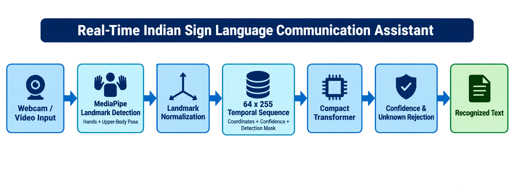
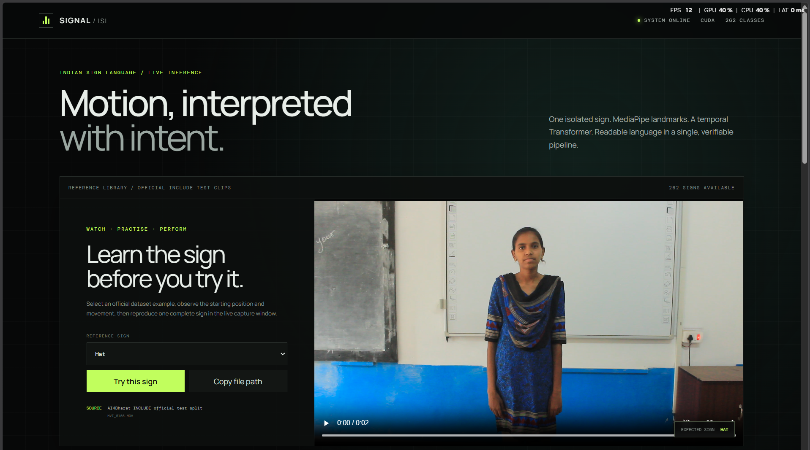
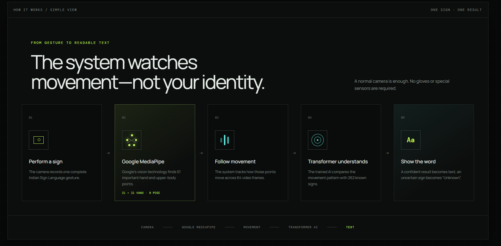
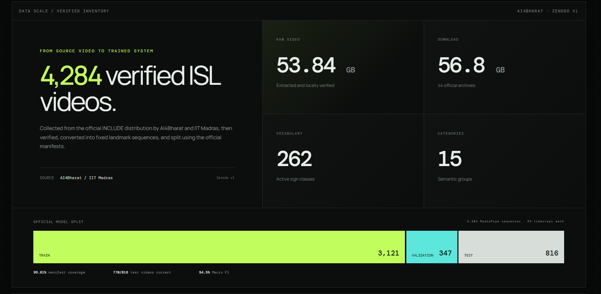
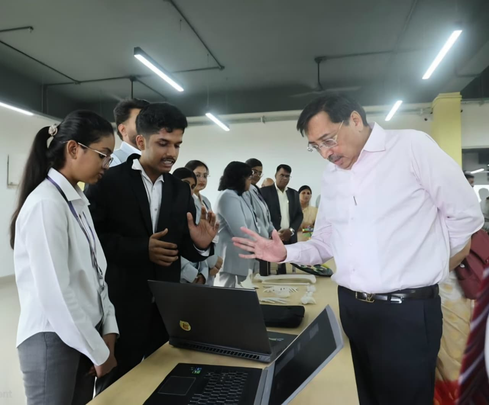

<h1 align="center">Real-Time Indian Sign Language<br>Communication Assistant</h1>

<p align="center">
  A university final-year project<br>
  <strong>Bachelor of Technology in Computer Science and Engineering</strong>
</p>

<p align="center">
  November 2026
</p>

<p align="center">
  <strong>Keyur Sherke · Divya Lonare · Lucky Dhepe · Alkesh Soni</strong>
</p>

<p align="center">
  
  
  
  
  
  <br>
  
  
  
  
</p>

<p align="center">
  <a href="#project-overview">Overview</a> ·
  <a href="#benchmark-results">Results</a> ·
  <a href="#project-team">Team</a> ·
  <a href="#application-outputs">Application</a> ·
  <a href="#project-showcase">Showcase</a> ·
  <a href="#run-the-project">Run locally</a>
</p>

## Project overview

Indian Sign Language communicates through hand shape, position, movement,
and body configuration. This project investigates recognition of one complete
isolated sign from an uploaded video or a manually captured webcam sequence.
Google MediaPipe extracts hand and upper-body landmarks; a trained temporal
classifier converts their movement into a predicted sign label.

The work covers dataset preparation, manifest-driven landmark extraction,
feature validation, model comparison, and application integration. SVM and
LSTM provide reference baselines, while a Compact Transformer is the selected
application model. A React interface connects to FastAPI for uploaded-video
prediction, browser landmark capture, reference videos, and quality feedback.

On the locally available 262-class INCLUDE benchmark, the selected Transformer
achieved **94.36% test accuracy** and **94.47% test Macro F1**. New-user webcam
recognition remains inconsistent. This is an isolated-sign research prototype;
continuous conversation and grammatical ISL translation remain outside its
evaluated scope.

## Recognition pipeline

<p align="center">
  
</p>

1. Capture one complete gesture or upload an isolated-sign video.
2. Detect **51 landmarks**: 21 per hand and nine selected upper-body pose points.
3. Normalize coordinates using the shoulders, sample up to **64 frames**, and
   pad shorter clips with masks for missing timesteps.
4. Form **255 features per frame**: 153 coordinates, 51 confidence values,
   and 51 detection indicators.
5. Run the saved Compact Transformer and apply quality/confidence checks.
6. Display a sign label or `unknown`, ranked probabilities, coverage, and latency.

Uploaded videos are processed by backend MediaPipe. Webcam capture uses
browser MediaPipe and sends the captured landmark sequence to the Python API.
The browser draws the connected points; the backend runs the sign classifier.

## Dataset and preprocessing

The model experiments use **AI4Bharat's INCLUDE dataset**. The official manifests
contain 4,292 videos across 263 classes. Eight videos from `Second (Number)` were
unavailable locally; that class was explicitly excluded from the larger benchmark.

| Benchmark | Classes | Training | Validation | Test | Total |
|---|---:|---:|---:|---:|---:|
| INCLUDE-50 pilot | 50 | 689 | 77 | 192 | 958 |
| Local full INCLUDE | 262 | 3,121 | 347 | 816 | 4,284 |

The recorded local inventory includes **53.84 GB of extracted video**. The
download inventory records **44 archives / 56.8 GB**. These are data-storage
figures, not the sizes of the trained model or the repository.

Landmarks are stored in compressed `.npz` archives with labels, split identities,
timestamps, confidence, and detection masks. Extraction supports resuming completed
archives. Validation and quality reports check file integrity and manifest coverage.
Kaggle ISL and ISLVT were explored during collection but are not included in these
reported training and test results.

## Benchmark results

### Local full INCLUDE: 262 classes

| Model | Validation accuracy | Validation Macro F1 | Test accuracy | Test Macro F1 | Correct test clips |
|---|---:|---:|---:|---:|---:|
| RBF SVM | 50.43% | 43.20% | 53.92% | 51.05% | 440 / 816 |
| LSTM | 68.01% | 62.48% | 64.83% | 64.01% | 529 / 816 |
| **Compact Transformer** | **92.80%** | **91.65%** | **94.36%** | **94.47%** | **770 / 816** |

Configurations were selected using validation Macro F1. Final models were refitted
on training plus validation data before test evaluation. The selected Transformer
used seed 42 and a validation-selected epoch count of 62. Test results are frozen;
the application benchmark panel displays these recorded values rather than
rerunning evaluation for every request.

### INCLUDE-50 pilot: 50 classes

| Model | Test accuracy | Test Macro F1 |
|---|---:|---:|
| SVM | 67.19% | 63.94% |
| LSTM | 71.35% | 63.16% |
| **Compact Transformer** | **97.92%** | **97.83%** |

GRU was also evaluated on INCLUDE-50 validation data, reaching **75.87% Macro F1**;
it was not independently evaluated on the test split. These dataset results do
not establish accuracy for unseen webcam users or a signer-independent benchmark.

See the [full INCLUDE benchmark](documents/stage%206/03-full-include-model-benchmark.md)
and [INCLUDE-50 benchmark](documents/stage%206/01-include50-model-benchmark.md)
for configurations, evaluation protocol, and limitations.

## Project team

<table align="center">
  <tr>
    <td align="center" width="50%">
      <a href="https://github.com/KEYUR141">
        
      </a>
      <br>
      <strong>Keyur Sherke</strong><br>
      <a href="https://github.com/KEYUR141">@KEYUR141</a>
    </td>
    <td align="center" width="50%">
      <a href="https://github.com/divyalonare">
        
      </a>
      <br>
      <strong>Divya Lonare</strong><br>
      <a href="https://github.com/divyalonare">@divyalonare</a>
    </td>
  </tr>
  <tr>
    <td align="center" width="50%">
      <a href="https://github.com/luckydhepe">
        
      </a>
      <br>
      <strong>Lucky Dhepe</strong><br>
      <a href="https://github.com/luckydhepe">@luckydhepe</a>
    </td>
    <td align="center" width="50%">
      <a href="https://github.com/Akleshsoni">
        
      </a>
      <br>
      <strong>Alkesh Soni</strong><br>
      <a href="https://github.com/Akleshsoni">@Akleshsoni</a>
    </td>
  </tr>
</table>

**Implementation and repository maintainer:** [Keyur Sherke](https://github.com/KEYUR141).

## Application outputs

The following screenshots document the project interface used in the report
and presentation. Displayed status/latency values belong to the captured session;
they are not a separate performance benchmark.

### Reference-video and prediction interface

The reference library lets a user watch an official dataset example before
attempting one isolated gesture. The application also supports video upload,
manual webcam capture, visible landmarks, and ranked prediction results.

<p align="center">
  
</p>

*Reference video shown in the interface: AI4Bharat INCLUDE official test split.*

### Five-stage system explanation

The presentation interface explains the path from a captured gesture through
Google MediaPipe and the temporal model to a displayed label.

<p align="center">
  
</p>

### Dataset inventory and benchmark split

The inventory panel presents the recorded video count, download size, active
vocabulary, and training/validation/test split used by the local benchmark.

<p align="center">
  
</p>

## Project showcase

<p align="center">
  
</p>

**Keyur Sherke and Divya Lonare presenting the project to the university
Chancellor** during the inauguration of the university's incubation centre.
This photograph is also included in the project report appendix.

## Run the project

### Prerequisites

- Python **3.12**, `uv`, and a Node.js/npm installation compatible with the frontend.
- The INCLUDE videos, manifests, label maps, and extracted features at the paths
  configured in `configs/landmarks_include.toml` or `configs/landmarks.toml`.
- A trained temporal checkpoint, such as `selected_final.pt`, and the MediaPipe
  hand/pose task files. Dataset files and trained checkpoints are not bundled here.
- For `--device cuda`, an NVIDIA GPU, a compatible driver, and CUDA-enabled
  PyTorch. The current project configuration selects PyTorch's `cu130` wheel index.

Commands below use Windows PowerShell from the repository root. Installation
and model downloads can take time:

```powershell
uv sync --group dev
powershell -ExecutionPolicy Bypass -File scripts/download_mediapipe_models.ps1
Push-Location frontend
npm install
Pop-Location
```

### Start the API

Update the checkpoint path for your machine, then keep this terminal open:

```powershell
uv run python scripts/run_api.py --checkpoint "E:\Hugging_Face\INCLUDE\processed\mediapipe_v1\models\full_include\transformer_final_seed_42\selected_final.pt" --device cuda
```

Use `--device cpu` for CPU inference. Open `http://127.0.0.1:8000/docs` for API
documentation. The first inference request loads the trained model.

### Start React in another terminal

```powershell
cd frontend
npm run dev -- --port 5173 --strictPort
```

Open **http://127.0.0.1:5173**. Vite forwards `/api` requests to port **8000**.
Allow camera permission to use live points and manual webcam capture.

For individual model training, a sequential all-model run, prediction commands,
quality reports, and diagnostics, use **[cmd.txt](cmd.txt)**. Training is not
required to demonstrate an existing checkpoint. The combined temporal trainer
tests only its validation winner with `--evaluate-test`; the command guide also
provides independent runs for each architecture.

## Project documentation

| Material | Location |
|---|---|
| Complete command reference | [cmd.txt](cmd.txt) |
| Presentation and viva notes | [presentation.md](presentation.md) / [presentation.txt](presentation.txt) |
| Model workflows, epochs, seeds, and checkpoint terminology | [Training terminology](documents/stage%206/02-model-workflows-and-training-terminology.md) |
| INCLUDE-50 model benchmark | [Pilot benchmark](documents/stage%206/01-include50-model-benchmark.md) |
| Full local INCLUDE model benchmark | [Full benchmark](documents/stage%206/03-full-include-model-benchmark.md) |
| Frontend operation and demonstration | [Frontend README](frontend/README.md) |
| Project progress | [progress.md](progress.md) |
| Implementation plan | [plan.md](plan.md) |

### Repository structure

```text
configs/                    Dataset paths and MediaPipe model configuration
scripts/                    Extraction, validation, training, API and webcam tools
src/isl_assistant/
  data/                     Manifests, feature loaders and quality reports
  vision/landmarks/         Detection, sampling, normalization and extraction
  models/                   GRU, LSTM and Transformer classifiers
  inference/                Checkpoint loading, capture and decision logic
  api/                      FastAPI routes and inference service
frontend/                   React/Vite presentation interface
tests/                      Automated pipeline and application tests
documents/                  Research notes, benchmarks and README images
```

## Current limitations and future scope

The strongest results apply to the selected INCLUDE dataset splits. Newly
recorded webcam gestures can be rejected or misclassified because capture
boundaries, landmark quality, signing style, and recording conditions vary.
A high prediction probability does not guarantee correctness. `unknown` is a
rejection decision, not a trained class covering every unfamiliar sign.

Future work includes consented recordings from more signers, signer-independent
evaluation, consistent live preprocessing, calibrated rejection thresholds,
and measured end-to-end latency. Continuous sign segmentation and sentence-level
interpretation require additional data and evaluation.

## Dataset and tool acknowledgements

The project uses the **AI4Bharat INCLUDE dataset**, **Google MediaPipe**,
**PyTorch**, **scikit-learn**, **NumPy**, **OpenCV**, **FastAPI**, **React**, and
**Vite**. Dataset ownership and third-party software licenses remain with their
respective providers. Research references and experiment details are recorded
in the documentation linked above.

## License

The original project code is licensed under the [MIT License](LICENSE).
Third-party datasets, pretrained model assets, software dependencies, and
photographs are not relicensed by this notice; their respective licenses
and permissions apply.
